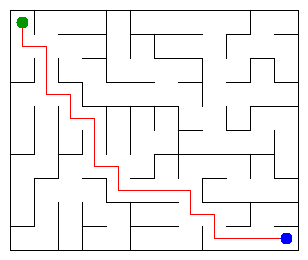

# Assignment 3. Maze Escape

Student ID: 253205  
Name: Aibek Baimakhan
Group: SE-2512
Maze size (rows x columns): 10 x 12

This project is written in Java. It builds a maze, finds an escape path, and calculates the cheapest routes using graph algorithms.

## Program output

Results from `java -cp out Main` on my generated maze:

```text
Broken: 119
Kept: 99
Last broken wall: 180
MST cost: 34118
Heaviest broken wall: 722
Path length: 20
DFS visited: 91
Dead ends: 35
Zones: 10
Largest zone: 25
Is DAG: 0
Flow stages: 7
Fastest route cost: 24
```

My maze:



## Questions

**Mission 0. What do find and union do, and what makes them fast in your code?**

`find` returns the root of the set containing a cell, and `union` joins two sets if they are different. I used path compression and union by size to make repeated operations faster.

**Mission 1. Why is Broken always R*C - 1, and Kept always (R-1)*(C-1)?**

There are `R*C` cells, and every broken wall joins two different groups. To connect all the cells without a cycle, we break `R*C - 1` walls; the remaining number of inner walls is `(R-1)*(C-1)`.

**Mission 2. My MST cost from Kruskal and from Prim, and why they are equal:**

Kruskal and Prim both gave an MST cost of `34118` on my maze. They give the same result because both algorithms find a minimum spanning tree with the smallest possible total cost.

**Mission 3. Why is there exactly one path between two cells? How did you avoid a stack overflow on a huge maze?**

The maze is a tree, so there is exactly one path between any two cells. I used an array as an explicit stack for DFS instead of recursive calls, so it also works for large mazes.

**Mission 4. Why does the second pass of Kosaraju go on the reversed graph? Why do the slides have no cycle exactly when Zones equals the number of cells?**

The second pass uses reversed edges to collect cells from the same strongly connected component. Since there are no self-slides, a directed cycle would put at least two cells in one zone; if every cell has its own zone, there is no cycle.

**Mission 5. Why is it enough to go through the zones in the order of their numbers? What does this pass cost?**

The zone numbers follow a topological order, so edges between zones go forward. I process the zones once and update the longest chain and the cheapest route; the pass takes `O(z + s)` time, where `z` is the number of zones and `s` is the number of slides between zones.

## AI use

I used ChatGPT to help draft parts of the Java code for DSU, maze generation, Kruskal, Prim, DFS, Kosaraju, and the route calculations. I also used it to help with debugging, checking the test output, and preparing this README. I ran the tests and benchmarks in IntelliJ IDEA and checked the maze in a browser.

## Timing (Mission 7)

Times are in milliseconds. Each algorithm was run 5 times using `java -cp out Bench`.

| Maze | Kruskal (average) | Prim (average) |
|---|---:|---:|
| 100 x 100 | 14 ms | 10 ms |
| 300 x 300 | 71 ms | 58 ms |
| 1000 x 1000 | 1271 ms | 1402 ms |

Both algorithms took more time as the maze became larger. Prim was faster for the 100 x 100 and 300 x 300 mazes in this run, but Kruskal was a little faster for the 1000 x 1000 maze. The results can vary between runs.

## Complexity

Let `n` be the number of cells and `m` be the number of walls or slides, as appropriate.

| Algorithm | Time | Extra space | Assumptions |
|---|---|---|---|
| DSU `find` and `union` | `O(α(n))` amortized | `O(n)` | Path compression and union by size; space includes the DSU arrays |
| Kruskal | `O(m log m + m α(n))` | `O(n + m)` | Sort walls by cost and use DSU |
| Prim | `O(m log m)` | `O(n + m)` | Adjacency lists and priority queue |
| DFS | `O(n + m)` | `O(n + m)` | Iterative traversal; the finished maze is a tree |
| Kosaraju | `O(n + m)` | `O(n + m)` | Two iterative passes and a reversed graph |
| Route in the zone graph | `O(n + m)` | `O(n + m)` | Zone graph is a DAG; each zone and slide is processed a constant number of times |

## Before you submit

- [ ] Replace the student ID, name, and group placeholders; check the maze size against `data/walls.txt`.
- [ ] Read the answers and adjust the wording so they reflect your own understanding and work.
- [ ] Verify Kruskal and Prim have the same cost on your own data.
- [ ] Make sure `data/walls.txt`, `data/slides.txt`, and `output/maze.png` are committed.
- [ ] Run `java tools/Check.java` and confirm that all examples pass.
- [ ] Check at least 7 meaningful Git commits and push the `main` branch.
- [ ] Submit the public GitHub repository link in Moodle before the deadline.
